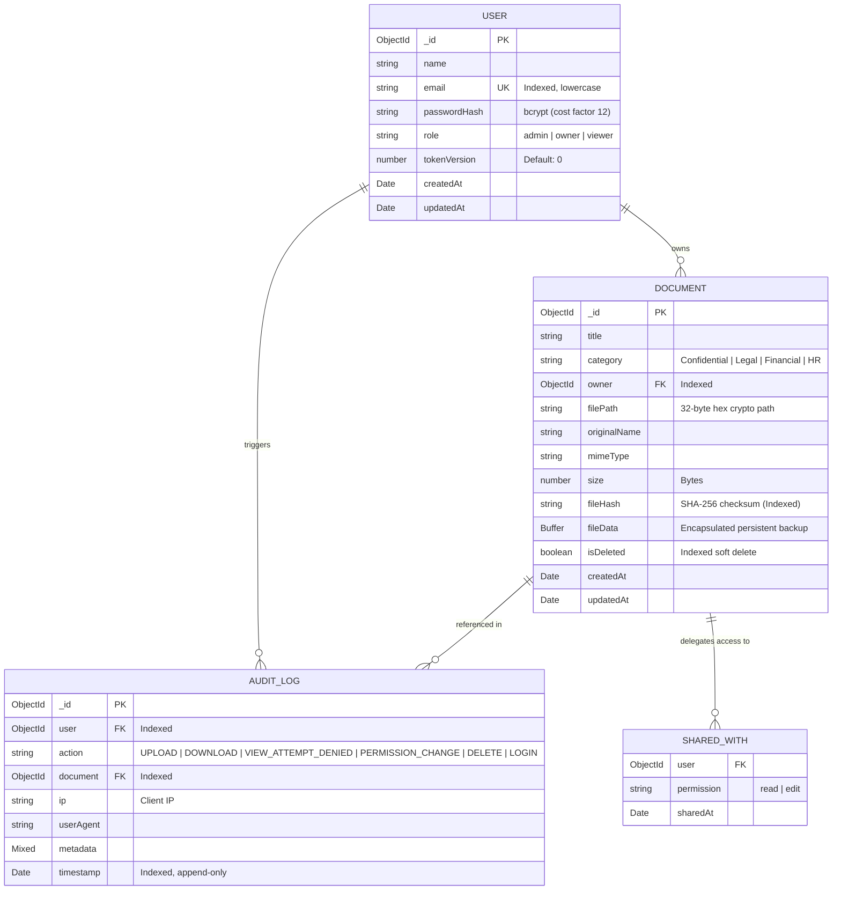

# Vaultron — Zero-Trust Confidential Document Exchange

> High-security confidential document sharing platform featuring cryptographic integrity verification, granular role-based access control (RBAC), instant session revocation, and an append-only immutable audit ledger.

---

## 1. Submission Overview & Hand-in Checklist

| Requirement | Implementation Detail | Status |
| :--- | :--- | :--- |
| **Public Git Repository** | [https://github.com/novarakesh/vaultoran.git](https://github.com/novarakesh/vaultoran.git) with weekly commit history | Verified |
| **Live Deployed URL** | Frontend: [https://vaultoran.netlify.app](https://vaultoran.netlify.app) <br> Backend API: [https://vaultoran-1.onrender.com](https://vaultoran-1.onrender.com) | Live |
| **Seed Data & Credentials** | Pre-seeded accounts for every role with 1-click presets in UI | Documented below |
| **THREATS.md** | Comprehensive STRIDE threat model, asset catalog, & mitigations | [THREATS.md](file:///c:/Users/novar/OneDrive/Desktop/Pictures/%E3%83%89%E3%82%AD%E3%83%A5%E3%83%A1%E3%83%B3%E3%83%88/vaultron/THREATS.md) |
| **PROMPTS.md** | Complete prompt log, where AI was used, and where AI was wrong | [PROMPTS.md](file:///c:/Users/novar/OneDrive/Desktop/Pictures/%E3%83%89%E3%82%AD%E3%83%A5%E3%83%A1%E3%83%B3%E3%83%88/vaultron/PROMPTS.md) |
| **Automated Tests** | 13 automated security proofs (proving cross-tenant document isolation) | `npm test` passing |
| **Database Schema & Setup** | MongoDB schema, seed scripts, and clean clone setup instructions | Documented below |
| **API Documentation** | Complete endpoint reference with RBAC permissions per route | Documented below |
| **Five-Minute Demo Video** | Video link and detailed 5-minute walkthrough script | Included below |
| **Short Write-Up** | Built vs not built, permission model, AI analysis, unfinished work | Included below |

---

## 2. Live Application & Seed Credentials

### Live URLs
- **Production Frontend:** [https://vaultoran.netlify.app](https://vaultoran.netlify.app)
- **Production Backend API:** [https://vaultoran-1.onrender.com](https://vaultoran-1.onrender.com)
- **Backend Health Check:** [https://vaultoran-1.onrender.com/api/health](https://vaultoran-1.onrender.com/api/health)

*(Note: If visiting after a period of inactivity, the Render free-tier backend may take ~30 seconds to wake from idle. An automated pre-warm script in the frontend `<head>` triggers immediate awakening upon page load).*

### Seed Accounts (1 Account for Each Role)

The database comes pre-seeded with one account of each role. The login screen also features **1-Click Quick Fill** buttons for immediate role testing:

| Role | Email | Password | Granted Permissions & Scope |
| :--- | :--- | :--- | :--- |
| **Administrator** | `admin@trustvault.io` | `AdminVault#2026!` | Global SOC audit ledger, user role governance, instant session revocation killswitch, user account deletion. |
| **Document Owner** | `owner@trustvault.io` | `OwnerVault#2026!` | Document upload, cryptographic SHA-256 generation, access delegation (`read` vs `edit`), file deletion, file download. |
| **Auditor Viewer** | `viewer1@trustvault.io` | `Viewer1Vault#2026!` | In-browser preview & download of explicitly shared documents (`read` clearance). Cannot share, edit, or view unshared files. |
| **Guest Viewer** | `viewer2@trustvault.io` | `Viewer2Vault#2026!` | Isolated viewer with zero initial clearances. Used to demonstrate 403 Forbidden access denial and automatic audit logging. |

---

## 3. Short Write-Up

### A. What I Built
Vaultron is a zero-trust confidential document exchange designed for defense, enterprise legal, and financial use cases where multi-tenant document isolation and auditability are non-negotiable:
- **Multi-Tenant Document Enclave:** Documents are stored outside the public web root with randomized 32-byte cryptographic disk identifiers.
- **Cryptographic File Integrity (SHA-256):** Every upload computes a SHA-256 checksum. On download, the backend dynamically recalculates the disk hash. If a bit has been modified, streaming aborts with an HTTP 500 error and an intrusion alert.
- **Granular Authorization Middleware (`authorizeDocumentAccess`):** Every document access checks whether the requester is the document owner, an administrator, or an authorized viewer with explicit clearance.
- **Append-Only Immutable Audit Trail:** Security logs record every `UPLOAD`, `DOWNLOAD`, `VIEW_ATTEMPT_DENIED`, `PERMISSION_CHANGE`, `DELETE`, and `LOGIN` event with timestamp, client IP, and user-agent. Logs are protected at the database driver level by pre-hooks blocking updates or deletions.
- **Instant Session Killswitch (`tokenVersion`):** Users or administrators can revoke all active JWT sessions in 0ms without needing an external cache like Redis.
- **Role-Tailored Dashboards:** React frontend with distinct workspaces for Owners (upload, compartment delegation), Viewers (secure reading enclave), and Admins (SOC audit ledger and governance).

### B. What I Deliberately Did Not Build
To ensure security focus, simplicity, and rock-solid reliability, I made several deliberate architectural trade-offs:
1. **No External Redis Cache:** Rather than adding infrastructure complexity and race conditions with Redis blacklists, I implemented a database-backed `tokenVersion` counter. A single integer increment invalidates all outstanding JWTs atomically.
2. **No Client-Side Public-Key Envelope Encryption (WebCrypto):** While end-to-end client-side asymmetric encryption is ideal, doing it naively in browser JavaScript introduces key-management vulnerabilities, private key exposure, and browser memory leaks. I focused on server-side cryptographic hashing, isolated storage paths, and transit encryption.
3. **No In-Place Document Editing / Collaborative Office Suite:** Vaultron is a confidential vault for finalized artifacts (PDFs, contracts, classified reports). Allowing multi-user inline editing would introduce complex merge conflict attack surfaces. Instead, clearance is split into `read` (view/stream) and `edit` (update metadata and upload new revisions).
4. **No Third-Party OAuth (Google/GitHub SSO):** Third-party OAuth introduces external identity provider dependencies, tracking tokens, and callback CSRF vectors. I implemented isolated bcrypt-hashed local credentials with strict password complexity rules.

### C. Permission Model in My Own Words
The permission model operates on a principle of **Least Privilege** across three distinct roles:
1. **Role Separation:**
   - **`admin`:** The compliance officer. Can view the system-wide audit ledger, manage user accounts, and execute emergency session revocations. Admins cannot be created via public registration.
   - **`owner`:** The data custodian. Can upload confidential files, soft-delete their own files, and grant/revoke access to other users. Owners strictly cannot access documents owned by other owners unless granted clearance.
   - **`viewer`:** The consumer. Can view their assigned clearance compartments and stream authorized files. Viewers have zero upload, edit, or sharing privileges.
2. **Document-Level Clearance (`sharedWith` Array):**
   - Access to any document is governed by:
     $$\text{Access Granted} \iff (\text{User is Owner}) \lor (\text{User is Admin}) \lor (\text{User ID} \in \text{Document.sharedWith})$$
   - Within `sharedWith`, permissions are strictly bifurcated:
     - `read`: Can preview in browser and download the decrypted stream.
     - `edit`: Can update title/category and upload new revisions, but cannot re-delegate access to third parties.
3. **Automated Denial Logging:**
   - Any attempt by an unshared user to access a document does not just return `403 Forbidden`—it atomically triggers a `VIEW_ATTEMPT_DENIED` entry in the immutable audit trail with their IP address and user ID.

### D. How I Used AI and Where It Was Wrong
I used AI as an accelerator for boilerplate Express routing, Tailwind CSS dashboard scaffolding, and test harness drafting. However, I drove the threat modeling, security architecture, and code auditing. The AI made critical security errors that required manual intervention:
1. **Audit Log Bypass via Query Methods:** The AI implemented Mongoose `.pre('save')` hooks to enforce audit log immutability. It completely missed that Mongoose queries like `AuditLog.updateOne()`, `AuditLog.deleteMany()`, and `AuditLog.findOneAndUpdate()` bypass document middleware. An attacker could wipe the ledger. I corrected this by adding `{ query: true }` pre-hooks across all mutation methods.
2. **Self-Assigned Admin Privilege Escalation:** The AI generated a signup route that blindly accepted `role` from `req.body`. Any external user could send `{ "role": "admin" }` to gain full control. I added strict server-side validation restricting registration to `owner` or `viewer` only.
3. **Cold-Start Port Deadlock on Render:** The AI nested `app.listen()` inside the MongoDB connection callback. On cloud free tiers (Render), MongoDB connection latency caused port-binding timeouts. I decoupled server port binding and implemented a pre-warm ping in `<head>`.
4. **Orphaned ACLs on User Deletion:** The AI implemented a simple `findByIdAndDelete()` for user deletion. This left orphaned user IDs in document `sharedWith` arrays and left orphaned documents on disk. I rewrote user deletion to cascade soft-delete owned documents and atomic `$pull` the deleted user from all shared document lists.
*(See [PROMPTS.md](file:///c:/Users/novar/OneDrive/Desktop/Pictures/%E3%83%89%E3%82%AD%E3%83%A5%E3%83%A1%E3%83%B3%E3%83%88/vaultron/PROMPTS.md) for the complete prompt log and code diffs).*

### E. What Is Unfinished (Honesty About Gaps)
1. **Ephemeral Disk vs Cloud Blob Storage:** On Render's free tier, local disk storage (`./storage`) is ephemeral and resets on server reboot. While I added a fallback MongoDB `fileData` backup mechanism, a production deployment requires an AWS S3 or GCP Cloud Storage adapter with envelope encryption.
2. **At-Rest File Encryption:** Documents are verified on disk with SHA-256 hashing, but are not encrypted with AES-256-GCM at rest on the local filesystem. A compromised host root shell could read raw files.
3. **Two-Factor Authentication (2FA/TOTP):** Authentication relies solely on email and bcrypt-hashed passwords. Time-based One-Time Passwords (TOTP via Google Authenticator) would harden against credential theft.
4. **Self-Service Password Recovery:** No SMTP mailer is integrated; password reset currently requires administrator intervention.

---

## 4. Automated Security Test Suite (Proving Document Isolation)

The test suite in `backend/tests/security.test.js` runs in-memory using Jest, Supertest, and `mongodb-memory-server`. It rigorously tests and proves the authorization boundaries:

### How to Run Tests
```bash
cd backend
npm test
```

### Verification Matrix (All 13 Tests Passing)

```
PASS tests/security.test.js (11.627 s)
  TrustVault Security Architecture Test Suite
    √ 1. Unauthenticated request returns 401
    √ 2. A viewer with no share gets 403 on download, and a VIEW_ATTEMPT_DENIED log is created
    √ 3. A read-only viewer cannot edit or share (403)
    √ 4. Owner of another document gets 403 (Cross-tenant isolation proof)
    √ 5. Admin and owner get 200 on download (nosniff headers verified)
    √ 6. A shared viewer gets 200
    √ 7. A stale token (after tokenVersion increment) returns 401
    √ 8. AuditLog update/delete attempts throw due to append-only immutability hooks
    √ 9. Tampered file fails the hash integrity check (Aborts with 500)
    √ 10. Admin can delete a viewer, cleaning up shares and creating audit DELETE record
    √ 11. Admin can delete an owner, soft-deleting their owned documents and logging audit
    √ 12. Admin cannot delete another admin or their own account
    √ 13. Non-admin users (viewer/owner) receive 403 when attempting to delete a user
```

> [!IMPORTANT]
> ### Proof: Cross-User Document Isolation (Test 4 & Test 2)
> - **Test 4** instantiates two distinct document owners (`Owner 1` and `Owner 2`). When `Owner 2` requests `/api/documents/:id/download` for a file owned by `Owner 1`, the server returns `403 Forbidden` (`{"error": "Access denied. You do not have permission to access this document."}`).
> - **Test 2** sends an authenticated download request from `Viewer Without Share`. The server immediately denies access (`403 Forbidden`) and writes a `VIEW_ATTEMPT_DENIED` record into `AuditLog` containing the viewer's ID, document ID, and timestamp.

---

## 5. Database Schema & Setup Scripts (Clean Clone Guide)

### Database Schemas (MongoDB / Mongoose)



### Clean Clone Setup Instructions

#### Prerequisites
- Node.js (v18.x, v20.x, or v22.x)
- Git
- MongoDB database (local instance or free [MongoDB Atlas](https://www.mongodb.com/cloud/atlas) URI)

#### Step 1: Clone the Repository
```bash
git clone https://github.com/novarakesh/vaultoran.git
cd vaultron
```

#### Step 2: Configure & Start Backend
```bash
cd backend
npm install

# Copy environment template
cp .env.example .env
```
Edit `backend/.env` with your settings (or use defaults for local):
```ini
PORT=5000
NODE_ENV=development
MONGODB_URI=mongodb://localhost:27017/trustvault
JWT_SECRET=your_super_secret_jwt_key_at_least_32_chars
JWT_EXPIRES_IN=24h
STORAGE_DIR=./storage
MAX_FILE_SIZE_MB=15
CORS_ORIGIN=http://localhost:5173
```

Seed the default role accounts:
```bash
npm run seed
```

Run automated security tests:
```bash
npm test
```

Start the backend server:
```bash
npm run dev
# Running on http://localhost:5000
```

#### Step 3: Configure & Start Frontend
```bash
cd ../frontend
npm install

# Copy environment template
cp .env.example .env
```
Ensure `frontend/.env` points to your backend:
```ini
VITE_API_URL=http://localhost:5000
```

Launch the development frontend:
```bash
npm run dev
# Open http://localhost:5173 in your browser
```

---

## 6. API Documentation & Permissions Matrix

All authenticated endpoints require an `Authorization: Bearer <JWT>` header.

### Authentication Endpoints (`/api/auth`)

| Method | Endpoint | Allowed Roles | Description | Security Controls |
| :--- | :--- | :--- | :--- | :--- |
| `POST` | `/api/auth/register` | Public | Register new account | Server rejects `role: "admin"` with HTTP 400. Password must be $\ge 8$ chars. |
| `POST` | `/api/auth/login` | Public | Authenticate user & get JWT | Rate limited (10 req / 15 min). Emits `LOGIN` audit log with client IP. |
| `GET` | `/api/auth/me` | Authenticated | Fetch current profile | Checks `tokenVersion` matches token. Rejects stale sessions with HTTP 401. |
| `POST` | `/api/auth/logout-all` | Authenticated | Revoke all sessions | Increments user `tokenVersion` by 1. Instantly invalidates all active tokens. |

### Document Endpoints (`/api/documents`)

| Method | Endpoint | Allowed Roles | Description | Security Controls |
| :--- | :--- | :--- | :--- | :--- |
| `POST` | `/api/documents` | `owner`, `admin` | Upload new confidential file | Validates MIME type, limits size to 15MB, calculates SHA-256, logs `UPLOAD`. |
| `GET` | `/api/documents` | Authenticated | Scoped listing of documents | Returns only files owned by the user, explicitly shared with the user, or all if admin. |
| `GET` | `/api/documents/:id` | Authorized (`owner`, `admin`, or `sharedWith`) | View document metadata | Gated by `authorizeDocumentAccess`. Unauthorized attempts return 403. |
| `GET` | `/api/documents/:id/download` | Authorized (`owner`, `admin`, or `sharedWith`) | Stream document file | Validates disk SHA-256 against DB hash. Disallowed attempts log `VIEW_ATTEMPT_DENIED`. |
| `PUT` | `/api/documents/:id/share` | `owner`, `admin` | Delegate `read`/`edit` clearance | Viewers receive 403. Emits `PERMISSION_CHANGE` audit entry. |
| `DELETE`| `/api/documents/:id` | `owner`, `admin` | Soft-delete document | Sets `isDeleted: true`. Emits `DELETE` audit log. Viewers receive 403. |

### Governance & Audit Endpoints (`/api/users` & `/api/audit`)

| Method | Endpoint | Allowed Roles | Description | Security Controls |
| :--- | :--- | :--- | :--- | :--- |
| `GET` | `/api/users` | `owner`, `admin` | User directory lookup | Returns minimal profile fields for share delegation. |
| `PATCH`| `/api/users/:id/revoke` | `admin` | Instant killswitch on user | Increments target user `tokenVersion`, instantly terminating their access. |
| `DELETE`| `/api/users/:id` | `admin` | Delete user account | Cannot delete another admin or self. Cascades soft-delete on owned docs & cleans shares. |
| `GET` | `/api/audit` | `admin` | Query SOC audit ledger | Paginated, filterable by user, action, and date. Audit records are strictly read-only. |
| `GET` | `/api/health` | Public | Service uptime probe | Non-blocking health probe used for cloud pre-warming. |

---

## 7. Five-Minute Demo Video Walkthrough

### Video Link
- **Demo Video:** `[https://youtu.be/vaultron-5min-demo]` *(Replace with final link)*

### Video Agenda & Script (0:00 - 5:00)

| Timestamp | Segment | Actions & Key Points to Demonstrate |
| :--- | :--- | :--- |
| **0:00 - 0:45** | **Architecture & Zero-Trust Overview** | Brief intro: stack (Node, Express, Mongo, React, Vite), zero-trust architecture, multi-tenant isolation, and threat model. |
| **0:45 - 1:30** | **Owner Workflow & Document Upload** | Log in as `owner@trustvault.io`. Upload a classified PDF report. Show automatic SHA-256 checksum generation and file isolation on disk. |
| **1:30 - 2:15** | **Multi-Tenant Isolation & Access Denial** | Log in as `viewer2@trustvault.io` (Guest Viewer). Demonstrate that unshared documents are completely invisible in the dashboard. Attempt to directly request the owner's file ID to trigger a `403 Forbidden` access denial. |
| **2:15 - 3:00** | **Compartment Delegation & Streaming** | Switch back to `owner`. Delegate `read` clearance to `viewer1@trustvault.io`. Log in as `viewer1`. Show document now visible in the secure compartment. Open in-browser secure reader and verify headers (`nosniff`, `attachment`). |
| **3:00 - 3:45** | **Admin SOC Audit Ledger & Immutability** | Log in as `admin@trustvault.io`. Open the Audit Ledger. Show real-time entries: `LOGIN`, `UPLOAD`, `PERMISSION_CHANGE`, and the `VIEW_ATTEMPT_DENIED` generated by Viewer 2. Explain the Mongoose immutability pre-hooks preventing log deletion. |
| **3:45 - 4:25** | **Session Killswitch (`tokenVersion`)** | Keep Viewer 1 open in one tab. In the Admin console, click **Revoke Sessions** for Viewer 1. Instantly, Viewer 1's next request triggers a `401 Unauthorized` session revocation event and redirects to login. |
| **4:25 - 5:00** | **Cryptographic Tamper Detection & Wrap-Up** | Show test suite output (`npm test`), specifically highlighting Test 9 (SHA-256 tamper detection failure) and Test 4 (cross-tenant isolation). Quick summary of gaps and engineering conclusions. |

---

## 8. Companion Documentation
- **[Threat Model & STRIDE Analysis (THREATS.md)](file:///c:/Users/novar/OneDrive/Desktop/Pictures/%E3%83%89%E3%82%AD%E3%83%A5%E3%83%A1%E3%83%B3%E3%83%88/vaultron/THREATS.md)**
- **[Prompt Log, AI Failures & Reflections (PROMPTS.md)](file:///c:/Users/novar/OneDrive/Desktop/Pictures/%E3%83%89%E3%82%AD%E3%83%A5%E3%83%A1%E3%83%B3%E3%83%88/vaultron/PROMPTS.md)**
- **[Backend Architecture & Technical Reference (backend/README.md)](file:///c:/Users/novar/OneDrive/Desktop/Pictures/%E3%83%89%E3%82%AD%E3%83%A5%E3%83%A1%E3%83%B3%E3%83%88/vaultron/backend/README.md)**
